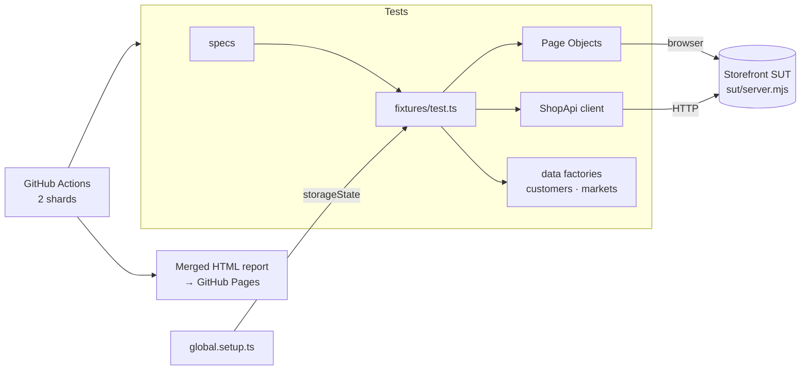

# Playwright E-Commerce E2E

[](https://github.com/mukeshn/playwright-ecommerce-e2e/actions/workflows/playwright.yml)
[](https://mukeshn.github.io/playwright-ecommerce-e2e/)


[](LICENSE)

End-to-end regression suite for a multi-market storefront: catalog, cart, promo codes, VAT for 10 EU shipping countries, guest and registered checkout, accessibility and the orders API.

The storefront under test ships with the repo (`sut/`), so the whole suite runs offline, in parallel and without flaky third-party demo sites. Point `BASE_URL` at a real environment and the same tests run there.

> **📊 [Open the latest HTML report →](https://mukeshn.github.io/playwright-ecommerce-e2e/)** (published by CI on every push to `main`, with traces for any failure)

---

## What's covered

| Area | Specs | Highlights |
|---|---|---|
| Authentication | `tests/auth` | data-driven negative cases, locked account, no credentials in URLs |
| Catalog | `tests/catalog` | search by name/SKU, category deep links, sort order assertions, stock badges |
| Cart & promotions | `tests/cart` | quantity rules, size variants, free-shipping threshold, `SAVE10` / `WELCOME5` / `FREESHIP` |
| Checkout | `tests/checkout` | guest + registered flows, field validation, in-flight button state, 409 stock conflict via `page.route` |
| Markets | `vat-by-market.spec.ts` | one basket priced for DE, AT, FR, NL, IT, ES, BE, CH, DK, SE |
| Accessibility | `tests/a11y` | axe-core WCAG 2.1 AA scan, keyboard-only checkout, `aria-invalid` |
| Mobile | `tests/mobile` | Pixel 7 emulation, burger menu, tap events |
| API | `tests/api` | order lifecycle, stock decrement, role-based access, aggregated validation errors |

## Architecture



**Design choices**

- **Fixtures over inheritance.** Page objects, the API client and `seedCart()` are injected through `test.extend`, so each spec asks only for what it needs.
- **API for setup, UI for behaviour.** Baskets are seeded straight into `localStorage` and orders are cross-checked against `/api/shop/pricing`. The UI is only driven where the UI is what's being tested.
- **One login per run.** `global.setup.ts` signs in once and stores `storageState`. Registered-customer specs reuse it via `test.use({ storageState })`.
- **Locators users would recognise.** `getByRole` and `getByLabel` come first, `data-testid` is the fallback, and there's no XPath.
- **Tags** (`@smoke`, `@regression`, `@a11y`, `@api`, `@mobile`) drive what runs where.

## Quick start

```bash
npm ci
npx playwright test               # full suite (starts the SUT automatically)
npm run test:smoke                # @smoke only
npx playwright test --project=mobile-chrome
npx playwright test --ui          # time-travel debugging
npm run report                    # open the last HTML report
```

Run against another environment:

```bash
BASE_URL=https://staging.example.com npx playwright test --grep @smoke
```

<details>
<summary><b>Project structure</b></summary>

```
├── src
│   ├── api/ShopApi.ts          # typed API client for setup + assertions
│   ├── data/                   # customer factory, market/VAT table
│   ├── fixtures/test.ts        # custom fixtures (page objects, seedCart, console guard)
│   └── pages/                  # page objects
├── tests
│   ├── a11y/  api/  auth/  cart/  catalog/  checkout/  mobile/
│   └── global.setup.ts         # authenticates once, saves storageState
├── sut/                        # storefront under test (Node, zero dependencies)
└── playwright.config.ts        # projects: setup · chrome · mobile-chrome · api
```
</details>

<details>
<summary><b>CI pipeline</b></summary>

- Runs on every push and PR, plus weekday mornings on a schedule to catch drift.
- The suite is split across **2 shards**. Blob reports are merged into one HTML report.
- The report is deployed to **GitHub Pages**, so failures come with screenshots and traces you can open in the browser.
- JUnit XML is uploaded for test analytics.
- Dependabot keeps Playwright, TypeScript and the workflow actions current every week.
</details>

<details>
<summary><b>Test users</b></summary>

| User | Password | Behaviour |
|---|---|---|
| `standard@shop.test` | `Passw0rd!` | regular customer |
| `locked@shop.test` | `Passw0rd!` | account locked |
| `admin@shop.test` | `Adm1n!2026` | can manage catalog via API |

These exist only in the bundled mock storefront.
</details>

## Related

- [playwright-banking-portal](https://github.com/mukeshn/playwright-banking-portal): OTP login, SEPA transfers, session timeout
- [playwright-sdet-lab](https://github.com/mukeshn/playwright-sdet-lab): 16 focused Playwright techniques
- [selenium-java-ecommerce-framework](https://github.com/mukeshn/selenium-java-ecommerce-framework): the same storefront tested with Selenium 4 + TestNG
